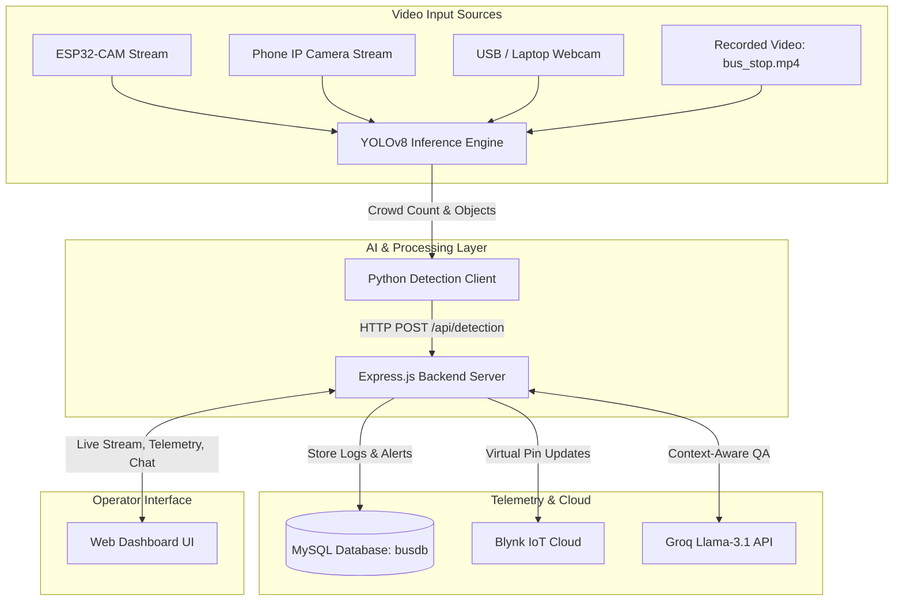

# 🚌 Smart Drone & Bus Crowd Detection System

[](https://python.org)
[](https://nodejs.org)
[](https://ultralytics.com)
[](https://www.mysql.com/)
[](https://blynk.io/)
[](https://groq.com/)
[](LICENSE)

An intelligent real-time crowd density monitoring, telemetry, and safety platform designed for smart public transit buses and surveillance drones. Powered by **YOLOv8 computer vision**, **ESP32-CAM / IP Camera streaming**, **MySQL data logging**, **Blynk IoT integration**, and an interactive **Groq Llama-3.1 AI Copilot**.

---

## 🌟 Key Features & Highlights

- **🎯 Real-Time YOLOv8 Crowd Counting**: Detects and counts passengers with precision, identifying crowd levels:
  - 🟢 `CLEAR` (0 passengers)
  - 🟡 `LOW` (1–4 passengers)
  - 🟠 `WARNING` (5–9 passengers)
  - 🔴 `DANGER` (10+ passengers - triggers automatic visual & database alerts)
- **📹 Multi-Stream Camera Support**:
  - Wireless **ESP32-CAM** video stream
  - **Phone IP Camera** (Android IP Webcam / iOS IP Camera over Wi-Fi)
  - Built-in **Laptop / USB Webcams**
  - **Pre-recorded video files** (e.g., `bus_stop.mp4` with automatic looping for testing)
- **📊 Real-Time Telemetry Dashboard**: Modern, glassmorphism-inspired dark mode UI providing live stream viewing, instantaneous passenger counters, object breakdown, and recent timestamped logs.
- **📍 Live GPS & Reverse Geocoding**: Automatically captures browser GPS coordinates and resolves human-readable addresses using OpenStreetMap Nominatim.
- **🤖 Embedded Groq Llama-3.1 AI Assistant**: Live transit AI copilot embedded in the dashboard that reads live passenger counts, GPS coordinates, and historical database statistics to answer operator questions.
- **☁️ Blynk IoT Integration**: Syncs passenger count data to virtual pins (`V0`) on the Blynk cloud for remote mobile app monitoring.
- **🗄️ MySQL Data Persistence**: Automatically logs detection telemetry, GPS coordinates, and threshold safety alarms to a relational MySQL schema.
- **🔐 Secure Environment Configuration**: Zero hardcoded credentials. All database passwords, Groq API keys, and Blynk tokens are managed through `.env`.

---

## 🏛️ System Architecture



---

## 📁 Repository Structure

```
├── drone_dashboard/
│   ├── public/
│   │   └── index.html             # Responsive real-time dashboard UI & AI Chatbot
│   ├── bus_detection.py           # Core YOLOv8 vision pipeline with multi-source video input
│   ├── mysql_workbench_busdb.sql  # Database schema creation script
│   ├── package.json               # Dashboard service dependencies
│   ├── server.js                  # Express API server, Blynk IoT connector & Groq AI endpoint
│   ├── yolov8n.pt                 # YOLOv8 nano model weights
│   └── yolov8s.pt                 # YOLOv8 small model weights
├── bus_detection_standalone.py     # Root convenience launcher for detection engine
├── bus_stop.mp4                   # Sample test video for demonstration & offline testing
├── index.html                     # Fast redirection entry point
├── package.json                   # Root package definition and scripts
├── requirements.txt               # Python package dependencies
├── .env.example                   # Template configuration file for secrets & settings
└── .gitignore                     # Git ignore rules protecting credentials & environments
```

---

## 🚀 Getting Started

### 1. Prerequisites

- **Node.js**: v18.0 or newer
- **Python**: v3.10 or newer
- **MySQL Server**: (MySQL Community Server, XAMPP, or MySQL Workbench)

---

### 2. Clone the Repository

```bash
git clone https://github.com/BHARATH9629/Drone-and-Bus-Crowd-Detection-System.git
cd Drone-and-Bus-Crowd-Detection-System
```

---

### 3. Setup Python Virtual Environment

```bash
# Create virtual environment
python -m venv venv

# Activate virtual environment
# On Windows (PowerShell):
.\venv\Scripts\Activate.ps1
# On Windows (cmd):
venv\Scripts\activate.bat
# On macOS/Linux:
source venv/bin/activate

# Install Python dependencies
pip install -r requirements.txt
```

---

### 4. Setup Node.js Backend

```bash
# Install Node dependencies
npm install
```

---

### 5. Configure MySQL Database

1. Open **MySQL Workbench** or your MySQL command line client.
2. Open and execute the provided SQL script:
   [`drone_dashboard/mysql_workbench_busdb.sql`](drone_dashboard/mysql_workbench_busdb.sql)
3. This creates the database `busdb` and the required tables:
   - `detection_logs`
   - `gps_logs`
   - `alerts`

---

### 6. Configure Environment Variables (`.env`)

Copy `.env.example` to `.env`:

```bash
cp .env.example .env
```

Edit `.env` and fill in your local credentials:

```env
# MySQL Database Configuration
DB_HOST=localhost
DB_USER=root
DB_PASSWORD=your_mysql_password
DB_NAME=busdb

# Blynk IoT Configuration (Optional)
BLYNK_AUTH_TOKEN=your_blynk_auth_token
BLYNK_BASE_URL=https://blynk.cloud/external/api/update

# Groq AI Assistant Configuration (Optional)
GROQ_API_KEY=gsk_your_groq_api_key_here
GROQ_MODEL=llama-3.1-8b-instant
GROQ_CHAT_URL=https://api.groq.com/openai/v1/chat/completions

# Camera IP Configuration (Optional defaults)
PHONE_CAM_IP=192.168.1.5
PHONE_CAM_PORT=8080
ESP32_IP=192.168.1.50
DASHBOARD_URL=http://localhost:3000/api/detection

# Server Port
PORT=3000
```

> **Security Note**: Never commit your `.env` file to Git. It is already included in `.gitignore`.

---

## 🎮 Running the Application

### Step 1: Start the Dashboard Server

From the project root:

```bash
npm start
```

The server starts at **`http://localhost:3000`**. Open your browser to access the live dashboard.

---

### Step 2: Start the Detection Pipeline

In a new terminal window (with Python virtual environment activated):

```bash
python bus_detection_standalone.py
```

You will be prompted to select a video input source:

```text
Select video/camera source:
  1. ESP32-CAM
  2. Phone Camera (IP Webcam)
  3. Laptop / USB Webcam
  4. Video File (e.g. bus_stop.mp4)
Enter choice [1/2/3/4]:
```

- Choose **`4`** to quickly test using the bundled sample video `bus_stop.mp4`.
- Choose **`3`** to test with your laptop or desktop webcam.
- Choose **`1`** or **`2`** to stream wirelessly from an ESP32-CAM or smartphone.

---

## 📡 API Endpoints

| Method | Endpoint | Description |
|---|---|---|
| `GET` | `/api/detection` | Returns latest crowd count, crowd status, and detected objects |
| `POST` | `/api/detection` | Ingests new detection frames from the Python YOLO client |
| `POST` | `/api/gps` | Ingests GPS coordinates and reverse-geocoded location data |
| `GET` | `/api/logs` | Returns the 50 most recent detection log entries |
| `GET` | `/api/alerts` | Returns recent crowd danger alert records |
| `POST` | `/api/chat` | AI Copilot query endpoint powered by Groq Llama-3.1 |

---

## 🔒 Security & Privacy

- All sensitive credentials (API tokens, database credentials, authentication keys) are stored strictly in environment variables.
- Git ignores `.env`, virtual environment directories, caches, and dependency folders.

---

## 📄 License

This project is licensed under the [MIT License](LICENSE).
